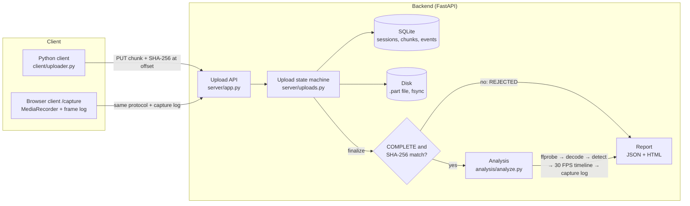

# Reliable Video Upload & Frame Integrity Detection

Confluentia 2026 (IIT BHU) · Nihilent nSEPIA Technical Challenge · solo submission by Sreenandh S.

Short write-up for judges (6 pages): [docs/nSEPIA-submission-Sreenandh-S.pdf](docs/nSEPIA-submission-Sreenandh-S.pdf).

A client sends a 30-second video to a backend over a network that swings between 20% and 100% strength. The
backend accepts the video **only when every byte has arrived and the whole-file SHA-256 matches**, then decodes
it, analyses it at 30 FPS and writes an integrity report that says where frames are missing, duplicated or
damaged, and **what evidence supports each conclusion**: transfer, capture or encoding.

## Results at a glance

All numbers come from real runs; the evidence files are in the repository.

| What | Result | Evidence |
|---|---|---|
| Uploads under emulated bad networks (netem + Toxiproxy, real Linux laptop): stable 20/60/100%, fluctuating, 10 s outage, network switch, TCP resets, 30 s hangs, client crash, server crash | **50/50 COMPLETE, SHA-256 verified in every run**, 0 harness errors | [nettest/EVIDENCE.md](nettest/EVIDENCE.md) |
| Damaged, partial or altered uploads | never accepted: damaged chunk rejected, incomplete upload cannot finalize, file changed mid-upload → `REJECTED` | `tests/test_m1_transfer.py` (16 tests) |
| Frame anomaly detector on 120 known-fault videos (held out, code frozen) | recall **0.933**, precision **0.995**, validation 100%, 0 false positives on clean videos | [testset/results/HELDOUT.md](testset/results/HELDOUT.md) |
| Altered, truncated and invalid videos | truncation located (`VALID_WITH_ERRORS`), fake files `INVALID`, flipped bytes located as corrupted frames | [docs/samples/](docs/samples/README.md), HELDOUT.md |
| Browser recording with per-frame capture log (Chrome webcam, iPhone Safari, headless) | uploads COMPLETE; the log tells **capture** from **encoding** drops (e.g. a 3.3 s camera gap = capture) | [evidence/m5/README.md](evidence/m5/README.md) |
| Automated tests | **82 passed** (`python -m pytest -q`; on a fresh clone 81 passed + 1 skipped, the Toxiproxy test, as Toxiproxy is not in git) | `tests/` |

## How each requirement of the brief is met

| Brief | How |
|---|---|
| Handle low bandwidth, latency, loss, disconnections, timeouts, switching | Resumable offset-based chunks, per-chunk SHA-256, retry with capped exponential backoff and jitter, 20 s stall timeout, chunk size adapts to the measured speed (64 KB–8 MB) |
| Recognise stalled, failed, partial transfers | Server states `UPLOADING → STALLED → FAILED`; `finalize` refuses an incomplete file; every state change is logged with a reason |
| Declare success only when intact; report final status | `finalize` re-reads the file from disk; only a matching SHA-256 gives `COMPLETE`, otherwise `REJECTED` |
| Proceed only after integrity checks | Analysis can open a file only through `uploads.verified_file()`, which refuses anything not `COMPLETE` with a matching hash |
| Validate and decode; record errors explicitly | ffprobe validates container and stream; PyAV decodes every frame and records every decoder message per packet; the ffmpeg CLI decodes again as an independent check |
| Extract frames at 30 FPS with timestamps and indices | Detection runs on the original timestamps; a 30 FPS timeline (slot → source frame) is then built and conversion duplicates are labelled as artefacts, not defects |
| Identify and localise anomalies | Missing frames, duplicated frames, possible skipped frames, irregular timing, timestamp errors, corrupted frames, truncation, each with time range, frame indices, evidence and confidence |
| Integrity report | JSON + HTML: transfer status, validation, anomalies, likely cause per anomaly, tool versions and limitations |
| Distinguish transfer from capture/encoding issues | A verified hash rules out transfer. Without more evidence the report says "cannot determine" (never "no drops"). The browser client adds a per-frame capture log that separates capture from encoding |

## Architecture



1. **Create a session.** The client declares the file size and SHA-256 (`POST /uploads`).
2. **Send chunks.** Each chunk goes to a byte offset with its own SHA-256 (`PUT /uploads/{id}/chunks?offset=`). The
   server stores only a contiguous, verified prefix and fsyncs before recording it. A re-sent identical chunk
   changes nothing.
3. **Recover from any failure the same way.** Whether the network drops, a timeout fires, or the client or server
   crashes, the client asks the server how many bytes it holds and continues from there.
4. **Finalize.** The server re-hashes the whole file. A match gives `COMPLETE`, anything else `REJECTED`.
5. **Analyse.** This starts automatically, and only for `COMPLETE` uploads. Analysis order: ffprobe validation,
   full decode, anomaly detection on original timestamps, then the 30 FPS timeline, then (if present) the capture
   log, then the report.

Why each choice was made: [docs/DESIGN.md](docs/DESIGN.md).

## Quick start

Needs Python 3.12 or 3.13 and FFmpeg (ffmpeg + ffprobe on PATH; tested with 9.0.2). Install FFmpeg with
`winget install Gyan.FFmpeg` on Windows or `sudo apt install ffmpeg` on Ubuntu.

```bash
python -m venv .venv
.venv/Scripts/activate            # Windows (Git Bash); Linux/macOS: source .venv/bin/activate
pip install -r requirements.txt
python -m pytest -q               # 82 tests, ~3-6 min. Browser tests need Chrome/Edge, one also nettest/bin/toxiproxy-server; skipped otherwise. Timing-sensitive: run on mains power
```

## Run it

```bash
uvicorn server.app:app --port 8000
```
Status page: http://127.0.0.1:8000/. Server data goes to `~/.nihilent-vi/data` (override with `VI_DATA_DIR`).

**Upload a video with the Python client** (resumes automatically if interrupted or re-run):
```bash
python -m client.uploader path/to/video.mp4 --server http://127.0.0.1:8000 --log upload.jsonl
```
It prints the final status as JSON (`state`, `client_sha256`, `server_sha256`, `hash_match`, retries, resumed
bytes). The server then analyses the file; the status page links the report (`/uploads/{id}/report.html`, JSON at
`/uploads/{id}/report`).

**Record in the browser:** open http://127.0.0.1:8000/capture in Chrome or Edge, press *Start recording*, pick
*Camera* (or *Test pattern* without a camera), press *Record 30 s and upload*. A phone needs HTTPS (camera access requires a secure context); see
[evidence/m5/README.md](evidence/m5/README.md) for the iPhone setup used.

**Analyse a local file** (no upload; transfer then counts as unverified):
```bash
python -m analysis.analyze path/to/video.mp4 --out reports/
```

**Make known-fault videos and score the detector:**
```bash
python -m testset.generate --out ~/.nihilent-vi/testset/seed2 --seed 2     # 24 videos + expected results
python -m testset.score --set ~/.nihilent-vi/testset/seed2 --out testset/results/seed2-heldout
```

**Network tests** (Linux, root, about 2 h): follow [nettest/RUNBOOK.md](nettest/RUNBOOK.md).

## Sample integrity reports

[docs/samples/](docs/samples/README.md) holds three 30 s known-fault videos uploaded through the system end to end
(duplicated + missing frames, truncated file, fake file), each next to what the generator says is in it. The
browser runs in [evidence/m5/](evidence/m5/README.md) show reports with a capture log; the webcam run, for
example, attributes a 3.3 s gap to the camera.

## Limitations

What the system cannot do, and what was not tested, is listed in [docs/LIMITATIONS.md](docs/LIMITATIONS.md). The
most important: a byte-perfect transfer cannot prove the recording has no dropped frames. Without a capture log the
report says *cannot determine* rather than *no drops*.

Network conditions were emulated (netem, Toxiproxy); the only real-device run is one iPhone recording over a
hotspot. I built this alone during end-semester exams, which left no time for a real mobile-network or real
connection-switch test. How I would run them is written down in LIMITATIONS.md.

## Third-party code

The two WebGL effects on the capture page, `server/static/specular.js` (glass edge on the pipeline nodes) and
`server/static/rays.js` (light rays behind the opening), are plain-JavaScript ports of the SpecularButton and
LightRays components from [React Bits](https://reactbits.dev) by David Haz, used under its MIT + Commons Clause
licence ([server/static/LICENSE-react-bits.md](server/static/LICENSE-react-bits.md)). The ports keep the original
shaders, remove React, and add one change: rendering stops while a recording or upload is running. The dust motes
in the rays are my addition. No other third-party front-end code is used; Python dependencies are listed in
`requirements.txt`.

## Repository layout

| Path | Content |
|---|---|
| `server/` | FastAPI app, upload state machine (SQLite + fsync'd files), analysis jobs, browser pages (`static/`) |
| `client/` | Python resumable uploader; headless-browser runner |
| `analysis/` | ffprobe validation, decoding, detection, 30 FPS timeline, capture-log evaluation, HTML report |
| `testset/` | known-fault video generator, scorer, results |
| `nettest/` | netem/Toxiproxy harness, runbook, results of the 50 runs |
| `evidence/m5/` | browser recording runs (reports + raw capture logs) |
| `docs/` | design notes, limitations, demo script, sample reports, the PDF write-up (source in `docs/submission/`) |
| `tests/` | pytest suite for every milestone |

Pinned dependencies: `requirements.txt`. Every report records the versions of Python, the OS, FFmpeg, PyAV,
OpenCV and NumPy that produced it.
